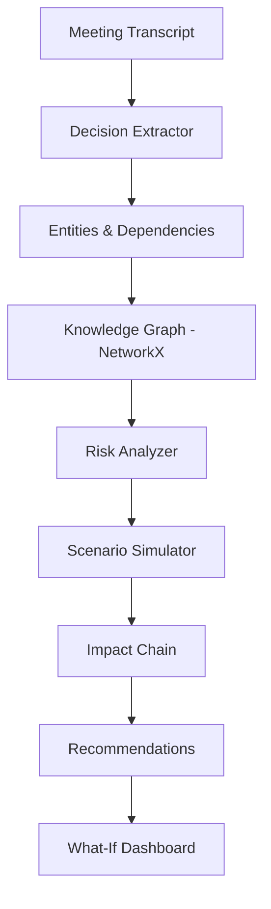
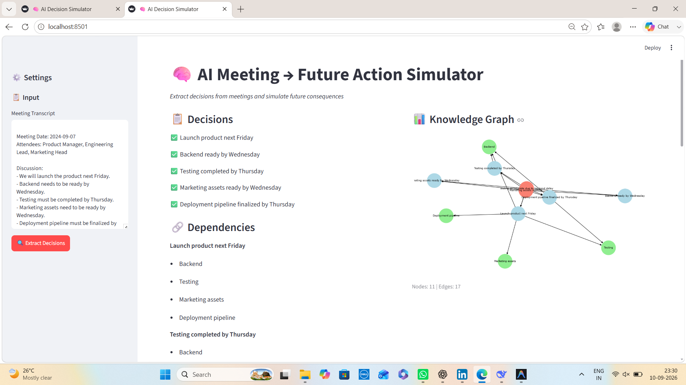
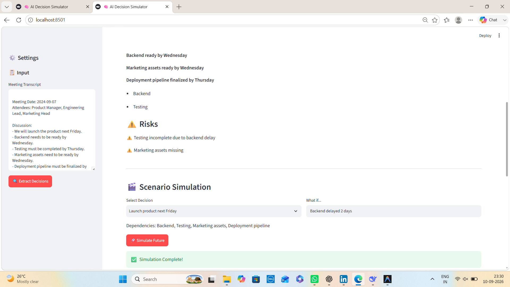
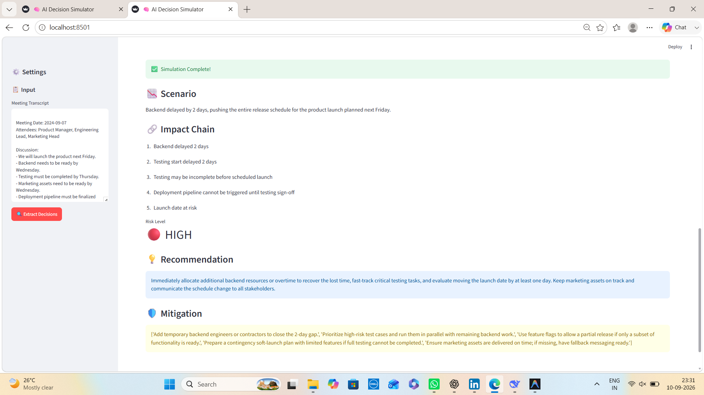

<p align="center">
  
  
  
  
  
  
</p>

<h1 align="center">🧠 AI Meeting → Future Action Simulator</h1>

<p align="center">
  <strong>An AI Decision Intelligence system that doesn't just summarize meetings — it extracts decisions, maps dependencies, detects risks, and simulates future consequences.</strong>
</p>

<p align="center">
  <i>Meeting → Decisions → Dependencies → Risks → Future Impact</i> 🚀
</p>

<p align="center">
  <a href="https://github.com/vaibhav07772/ai-decision-simulator">
    
  </a>
  <a href="https://github.com/vaibhav07772/ai-decision-simulator/issues">
    
  </a>
  <a href="https://github.com/vaibhav07772/ai-decision-simulator">
    
  </a>
</p>

---

## 📌 Overview

Traditional meeting tools usually stop at:

```text
Meeting
   ↓
Transcript
   ↓
Summary
```

**AI Meeting → Future Action Simulator** goes one step further:

```text
Meeting
   ↓
Decision Extraction
   ↓
Dependency Mapping
   ↓
Knowledge Graph
   ↓
Risk Analysis
   ↓
What-If Simulation
   ↓
Future Impact
   ↓
Recommendations & Mitigation
```

The system analyzes meeting transcripts, extracts important decisions, dependencies, deadlines, tasks, and risks, then represents their relationships as a knowledge graph.

Users can then simulate hypothetical scenarios such as:

> **"What if the backend is delayed by 2 days?"**

Instead of simply reporting the delay, the system attempts to trace potential downstream consequences:

```text
Backend Delay
      ↓
Testing Delay
      ↓
Deployment Delay
      ↓
Launch Risk
      ↓
Potential Business Impact
```

This makes the project an example of **AI-powered decision intelligence and scenario reasoning**, rather than a traditional meeting summarization application.

---

# ✨ Key Features

| Feature                           | Description                                                          |
| --------------------------------- | -------------------------------------------------------------------- |
| 📝 **Decision Extraction**        | Automatically extracts important decisions from meeting transcripts  |
| 🔗 **Dependency Mapping**         | Maps relationships between decisions, tasks, and dependencies        |
| 🕸️ **Knowledge Graph**           | Represents decisions and dependencies using NetworkX                 |
| ⚠️ **Risk Detection**             | Identifies potential risks and vulnerable dependencies               |
| 🎬 **What-If Simulation**         | Simulates hypothetical delays, failures, and changes                 |
| 🔮 **Future Impact Analysis**     | Traces possible downstream consequences                              |
| 📊 **Impact Visualization**       | Visualizes dependency and impact chains                              |
| 💡 **Mitigation Recommendations** | Suggests actions to reduce identified risks                          |
| 🖥️ **Interactive Dashboard**     | Provides an interactive Streamlit interface                          |
| 🤖 **LLM Reasoning**              | Uses Groq-powered LLM workflows for extraction and scenario analysis |

---

# 🧠 Core Idea

The central idea of this project is:

> **A meeting contains decisions, decisions create dependencies, dependencies create risks, and risks can create future consequences.**

The system attempts to make these relationships explicit.

### Example

A meeting contains:

```text
Launch the product next Friday.

Backend must be ready by Wednesday.

Testing must be completed by Thursday.

Marketing assets must be ready by Wednesday.

Deployment pipeline must be finalized by Thursday.
```

The system can represent this as:

```text
                    Product Launch
                   /       |       \
                  ↓        ↓        ↓
              Backend    Testing   Marketing
                 │          │
                 ↓          ↓
             Deployment ────┘
```

Now the user can ask:

```text
What if the backend is delayed by 2 days?
```

The system evaluates the dependency chain and produces a potential impact analysis.

---

# 🏗️ Architecture Flow



---

# 🔄 End-to-End Workflow

```text
                         USER
                           │
                           ▼
                  Meeting Transcript
                           │
                           ▼
                 ┌─────────────────┐
                 │ Decision        │
                 │ Extraction      │
                 └────────┬────────┘
                          │
              ┌───────────┼───────────┐
              ▼           ▼           ▼
          Decisions   Dependencies   Risks
              │           │           │
              └───────────┼───────────┘
                          ▼
                   Knowledge Graph
                          │
                          ▼
                    Risk Analysis
                          │
                          ▼
                   What-If Scenario
                          │
                          ▼
                   Impact Simulation
                          │
                          ▼
                    Recommendations
                          │
                          ▼
                   Streamlit Dashboard
```

---

# 🕸️ Knowledge Graph

The project uses **NetworkX** to model relationships between entities.

### Example Nodes

```text
Decision
Task
Dependency
Risk
Deadline
Project
```

### Example Relationships

```text
Decision ──depends_on──> Backend

Backend ──required_for──> Testing

Testing ──required_for──> Deployment

Deployment ──required_for──> Launch

Backend ──has_risk──> Delay
```

The graph provides a structured representation of the meeting and allows the simulator to trace downstream dependencies.

---

# 🎬 What-If Scenario Simulation

One of the core features is **scenario simulation**.

### Example Scenario

```text
What if:

Backend is delayed by 2 days?
```

The simulator analyzes the dependency chain.

### Impact Chain

```text
1. Backend delayed by 2 days
             ↓
2. Testing start delayed
             ↓
3. Testing completion becomes uncertain
             ↓
4. Deployment cannot proceed normally
             ↓
5. Launch schedule becomes at risk
```

### Example Result

```text
Risk Level: 🔴 HIGH

Potential Impact:
Launch timeline may be affected.

Recommended Actions:
• Allocate additional engineering resources
• Prioritize critical test cases
• Use feature flags where appropriate
• Prepare a contingency release plan
• Re-evaluate launch dependencies
```

> ⚠️ Scenario results are decision-support signals, not guaranteed predictions.

---

# 📊 Sample Input & Output

## Meeting Transcript

```text
Meeting Date: 2024-09-07

Discussion:

- We will launch the product next Friday.
- Backend needs to be ready by Wednesday.
- Testing must be completed by Thursday.
- Marketing assets need to be ready by Wednesday.
- Deployment pipeline must be finalized by Thursday.

Risks discussed:

- Testing may be incomplete if backend is delayed.
- Marketing assets might be missing.
```

---

## Extracted Decisions

```text
✅ Launch product next Friday

✅ Backend ready by Wednesday

✅ Testing completed by Thursday

✅ Marketing assets ready by Wednesday

✅ Deployment pipeline finalized by Thursday
```

---

## Knowledge Graph

Example:

```text
Nodes: 11
Edges: 17

Node Types:
• Decisions
• Dependencies
• Risks
• Tasks
• Deadlines
```

Conceptually:

```text
                     Launch
                    /  |   \
                   /   |    \
                  ↓    ↓     ↓
             Backend Testing Marketing
                │       │
                ↓       ↓
           Deployment ──┘
```

---

# 🎯 Scenario Simulation Example

### User Input

```text
Backend delayed 2 days
```

### Simulated Impact

```text
Backend delayed 2 days
        ↓
Testing delayed
        ↓
Testing may not finish on time
        ↓
Deployment delayed
        ↓
Launch date becomes uncertain
```

### Risk Level

```text
🔴 HIGH
```

### Recommendation

```text
Immediately evaluate additional engineering capacity,
prioritize critical testing, and prepare a contingency
release strategy.
```

### Mitigation Plan

* Add temporary backend engineering resources
* Prioritize high-risk test cases
* Use feature flags for partial releases
* Prepare a contingency soft-launch plan
* Ensure marketing assets remain on schedule

---

# 📸 Screenshots

> **Important:** These screenshots are stored inside the repository's `images/` folder and are embedded using relative Markdown paths, so they will render directly inside the GitHub README.

## 1. Decision Extraction & Knowledge Graph



*Meeting transcript se decisions, dependencies, risks, aur knowledge graph generate hote hain.*

---

## 2. Scenario Simulation Input



*User decision/dependency select karke hypothetical "What if..." scenario enter karta hai, jaise "Backend delayed 2 days".*

---

## 3. Future Impact Simulation Output



*System downstream impact chain, risk level, recommendations, aur mitigation actions display karta hai.*

---

# 🛠️ Tech Stack

| Layer               | Technology            | Purpose                                    |
| ------------------- | --------------------- | ------------------------------------------ |
| **Language**        | Python 3.11+          | Core development                           |
| **LLM**             | Groq                  | Decision extraction and scenario reasoning |
| **Orchestration**   | LangChain + LangGraph | Multi-step AI workflow                     |
| **Knowledge Graph** | NetworkX              | Dependencies, entities, and relationships  |
| **Visualization**   | Matplotlib            | Graph visualization                        |
| **Frontend**        | Streamlit             | Interactive dashboard                      |
| **Configuration**   | python-dotenv         | Environment variable management            |

---

# 📂 Project Structure

```text
ai-decision-simulator/
│
├── src/
│   ├── decision_extractor.py    # Extract decisions, dependencies, risks
│   ├── knowledge_graph.py       # Build graph with NetworkX
│   ├── simulator.py             # What-if scenario simulation
│   └── app.py                   # Streamlit application
│
├── images/
│   ├── dashboard.png            # Decision extraction + graph
│   ├── simulation_input.png     # Scenario input
│   └── simulation_output.png    # Impact simulation output
│
├── requirements.txt
├── .env.example
├── .gitignore
└── README.md
```

> 🔐 The real `.env` file should remain local and must never be committed to GitHub.

---

# 🚀 Getting Started

## Prerequisites

Make sure you have:

* Python `3.11+`
* Conda
* Git
* Internet connection
* Groq API key

---

## 1️⃣ Clone the Repository

```bash
git clone https://github.com/vaibhav07772/ai-decision-simulator.git
cd ai-decision-simulator
```

---

## 2️⃣ Create Conda Environment

```bash
conda create -n decision-sim python=3.11 -y
conda activate decision-sim
```

---

## 3️⃣ Install Dependencies

```bash
pip install -r requirements.txt
```

---

## 4️⃣ Configure API Key

Create a `.env` file in the project root:

```env
GROQ_API_KEY=your_groq_api_key_here
```

You can obtain a Groq API key from:

https://console.groq.com/keys

### 🔐 Security

Never commit your real API key to GitHub.

Recommended `.gitignore`:

```gitignore
.env
.venv/
venv/
__pycache__/
*.pyc
.ipynb_checkpoints/
```

---

## 5️⃣ Run the Application

```bash
streamlit run src/app.py
```

---

## 6️⃣ Access the Dashboard

Open:

```text
http://localhost:8501
```

---

# 🧪 Example Queries

Try scenarios such as:

```text
What if the backend is delayed by 2 days?
```

```text
What happens if testing is not completed before launch?
```

```text
What if the deployment pipeline is unavailable?
```

```text
What downstream tasks depend on the backend?
```

```text
Which decision has the highest risk?
```

```text
What should we do if the launch date cannot move?
```

---

# 🏢 Real-World Use Cases

| Industry                      | Use Case                                                      |
| ----------------------------- | ------------------------------------------------------------- |
| **Project Management**        | Analyze how delays affect project timelines                   |
| **Product Management**        | Understand feature dependencies and launch risks              |
| **Software Engineering**      | Analyze sprint dependencies and blockers                      |
| **Consulting**                | Convert client meeting decisions into structured intelligence |
| **Operations**                | Simulate operational disruptions                              |
| **Executive Decision Making** | Evaluate consequences of strategic decisions                  |
| **Program Management**        | Track dependencies across multiple workstreams                |

---

# 🆚 Traditional Meeting AI vs This Project

| Traditional Meeting AI        | AI Meeting → Future Action Simulator |
| ----------------------------- | ------------------------------------ |
| Meeting → Summary             | Meeting → Decision Intelligence      |
| Static output                 | Dynamic scenario analysis            |
| Summarization                 | Decision extraction                  |
| Limited dependency visibility | Knowledge graph                      |
| No what-if simulation         | What-if scenario engine              |
| Limited downstream reasoning  | Impact-chain analysis                |
| Action items                  | Risk + mitigation recommendations    |

---

# 🧠 Why This Project Is Different

Most meeting AI applications primarily focus on:

```text
Transcription
     +
Summarization
     +
Action Items
```

This project focuses on:

```text
Decision Intelligence
        +
Dependency Reasoning
        +
Risk Analysis
        +
Scenario Simulation
        +
Future Impact
```

The goal is not only to answer:

> **"What happened in the meeting?"**

but also:

> **"What could happen next if one of our assumptions changes?"**

---

# 🎯 Engineering Concepts Demonstrated

This project demonstrates practical knowledge of:

* LLM application development
* Prompt engineering
* LangChain
* LangGraph workflows
* Structured information extraction
* Knowledge graphs
* Graph-based dependency modeling
* Graph traversal
* Risk analysis
* Scenario simulation
* What-if reasoning
* Visualization
* Streamlit application development
* API integration
* Environment configuration
* Decision-support system design

---

# 🔮 Future Improvements

### 🕸️ Real Graph Database

* Neo4j integration
* Persistent decision graphs
* Scalable graph querying

### 📅 Multi-Meeting Intelligence

Track decisions across multiple meetings:

```text
Meeting 1
   ↓
Decision
   ↓
Meeting 2
   ↓
Decision Updated
   ↓
Meeting 3
   ↓
Final Outcome
```

### 💬 Collaboration Integrations

Potential integrations:

```text
Slack
Microsoft Teams
Google Meet
Zoom
Jira
Notion
```

### 📄 Report Generation

Generate:

```text
PDF Decision Reports
Risk Reports
Scenario Reports
Executive Summaries
```

### 📈 Historical Decision Analysis

Compare:

```text
Predicted Impact
       vs
Actual Outcome
```

This could eventually allow evaluation of how accurately the system predicts downstream consequences.

### 🐳 Production Deployment

Potential architecture:

```text
Frontend
   ↓
FastAPI
   ↓
AI Workflow
   ↓
Background Workers
   ↓
PostgreSQL
   ↓
Neo4j
   ↓
Cloud Deployment
```

Potential technologies:

```text
Docker
FastAPI
PostgreSQL
Neo4j
Cloud Deployment
Background Workers
```

---

# ⚠️ Limitations

Scenario simulation is based on the information available in the meeting transcript and the dependency graph generated by the system.

Therefore:

* Predictions are **not guaranteed outcomes**.
* Missing dependencies can produce incomplete impact chains.
* LLM-generated reasoning can contain errors.
* Risk levels should be treated as **decision-support signals**.
* Complex real-world situations may require additional domain knowledge.
* Human review remains important for high-impact decisions.

---

# 🎤 Interview Answer

### Short Version

> **"I built an AI Decision Intelligence system that goes beyond meeting summarization. It extracts decisions and dependencies from meeting transcripts, represents them as a knowledge graph using NetworkX, identifies risks, and allows users to run what-if scenarios. For example, if the backend is delayed by two days, the system traces downstream dependencies such as testing and deployment and generates a potential impact chain with risk and mitigation recommendations. I built the workflow using LangGraph, Groq, NetworkX, and Streamlit."**

### Technical Version

> **"The pipeline starts with a meeting transcript, which is processed through an LLM-based extraction workflow to identify decisions, entities, dependencies, deadlines, and risks. These relationships are represented as a directed knowledge graph using NetworkX. When a user provides a hypothetical scenario, such as a backend delay, the simulator propagates the change through the dependency graph to identify downstream effects. The resulting impact chain is then analyzed to produce a risk assessment and mitigation recommendations, which are presented through a Streamlit dashboard."**

---

# 💡 Key Learning

The major concept behind this project is:

```text
LLM
 +
Structured Data
 +
Knowledge Graph
 +
Graph Traversal
 +
Scenario Reasoning
 =
Decision Intelligence
```

This project demonstrates how LLMs can be combined with **structured systems and graphs** instead of relying only on free-form text generation.

---

# 🤝 Contributing

Pull requests are welcome!

For major changes, please open an issue first to discuss the proposed changes.

```bash
git checkout -b feature/new-simulation

git add .

git commit -m "Add new scenario simulation"

git push origin feature/new-simulation
```

Then open a Pull Request.

---

# 📜 License

This project is licensed under the **MIT License**.

You are free to:

* Use the project
* Modify the project
* Distribute the project
* Build upon the project

---

# 👨‍💻 Author

## Vishnu Narayan Tripathi , Mohammad Abrar Hussain


<p align="center">
  <i>Meeting → Decisions → Dependencies → Risks → Future Impact</i> 🚀
</p>
